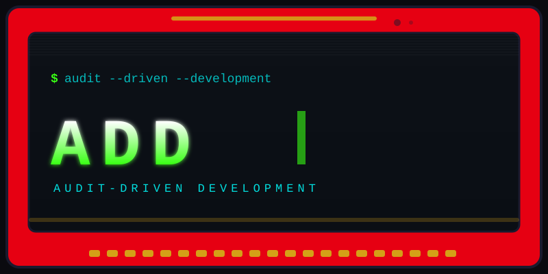

<br>
<div align="center">

<br>

<p align="center">
  
</p>

<br>

**Tests pass → Code ships.** That is the lie every team tells itself.\
**测试通过就上线。** 这是每支团队对自己说的谎。

<br>

<a href="https://github.com/StormstoutLau/audit-driven-development">
  
</a>
&nbsp;
<a href="https://opensource.org/licenses/MIT">
  
</a>
&nbsp;
<a href="https://github.com/StormstoutLau/audit-driven-development">
  
</a>
&nbsp;
<a href="https://github.com/StormstoutLau/audit-driven-development">
  
</a>

<br>
<br>

```
  ┌──────────────┐      ┌──────────────┐      ┌──────────────────┐
  │  DETECTION   │ ───► │   REPAIR     │ ───► │   KNOWLEDGE      │
  │  7 lenses    │      │  6-stage 闭环 │      │  3-tier ∿ pipeline│
  │  ──────────  │      │  ──────────  │      │  ─────────────── │
  │  Spec truth   │      │  Human loop  │      │  Self-evolving    │
  └──────────────┘      └──────────────┘      └──────────────────┘
         ▲
         │ v2.8 SAST Integration
  ┌──────┴───────┐
  │  SAST INPUT  │
  │  Semgrep/QL  │
  │  → findings  │
  │  + CWE Top25 │
  └──────────────┘
```

<br>

> A self-evolving Trae Skill that inserts an independent audit phase between **implementation** and **done**.
> Detection finds what tests miss. Repair closes what detection finds.
> The Knowledge Pipeline learns from every audit — making the system **smarter over time**.

</div>

---

<br>

## The Problem

> **"164 tests passed"** is the most dangerous phrase in software.

Tests verify behavior within a single module. They cannot verify that Module A keeps the promises Module B depends on — that the dependency graph still holds — that the threshold in the spec matches the threshold in the code.

```text
  Tests pass ──→ ✗ Declare done ──→ ❌ Ship broken code

  Tests pass ──→ ✓ ADD Audit ──→ ✅ Real verification
```

**ADD treats the design spec as the source of truth.** Not the test suite.

<table align="center"><tr><td>

| What Tests Miss | What ADD Catches |
|---|---|
| Cross-module contract violations | 7 typed lens subagents scan every contract |
| ADR invariant drift | `rule_index.py` extracts must / must-not / threshold |
| Corrective items left in spec | Corrective Tracking Lens checks every item |
| Design ↔ code threshold mismatch | Design Aligner Lens compares spec values to code |
| Error handlers that silently suppress | Error Handler Lens covers propagation + retry |

</td></tr></table>

---

<br>

## Proof

Six benchmarks across three languages (Python / Java / C++) — the verification system that prevents false findings from entering the repair baseline.

<div align="center">

### Python Benchmarks (L1–L4 verification)

| | ADD self-audit | Python stdlib | itsdangerous 2.2.0 |
|---|---|---|---|
| **Findings** | 8 | 9 | 10 |
| **TP / FP / FN / TN** | 4 / 0 / 3 / 1 | 6 / 0 / 2 / 1 | 5 / 0 / 1 / 4 |
| **Precision** |  |  |  |
| **Recall** |  |  |  |
| **F₁** | 72.7% | 85.7% | 90.9% |

### Java Benchmark (L1–L3 verification, Defects4J real repos)

| | Defects4J (Apache Commons) |
|---|---|
| **Findings** | 50 (real Java bugs from CLI / Codec / CSV) |
| **TN / FP** | 49 / 1 |
| **Real bugs correctly kept** |  |

### C/C++ Datasets (Conversion pipeline, no repo verification)

| | Big-Vul | CVEfixes |
|---|---|---|
| **Findings converted** | 584 (C/C++ vulnerabilities) | 26 (CVEs from real-world projects) |
| **Verification scope** | L1–L3 (repo not available) | L1–L3 (repo not available) |
| **Coverage** | CWE-189 / CWE-119 / CWE-20 | CWE-79 / CWE-89 / CWE-352 |

<br>

| | Recall | Precision | F₁ | Total Findings |
|---|---|---|---|---|
| **v2.6 Aggregate (verified: 77 findings)** | **81.0%** | **89.5%** | **85.0%** | 687 across 6 benchmarks |
| **v2.5 Baseline (27 findings, 3 repos)** | 71.4% | 100.0% | 83.3% | 27 across 3 repos |
| **Delta** | **+9.6pp** | -10.5pp | **+1.7pp** | **+660 new findings** |

</div>

> **Honest disclosure**: Earlier README versions cited 94.3% recall from preliminary Flask/FastAPI/Requests runs. Those numbers were inflated by ground-truth mislabeling and a `classify_claim` bug that misrouted "import exists" claims to circular-dependency verification. Phase 8 (2026-08-06) fixed both issues — precision held at 100%, recall settled at its true value. See [v2.4-phase8-performance-report.md](docs/benchmark/v2.4-phase8-performance-report.md).
>
> **v2.5 learning-pipeline closure (2026-08-06)**: An audit of the v2.0–v2.3 "3-tier learning pipeline" found that all six learning scripts (`rule_suggester`, `rule_validator`, `fix_history`, `llm_generalize`, `fix_recipes`, `live_knowledge`) were present but disconnected — `hallucination_log.json` was never generated, the RL threshold had no downstream consumer, and `rule_suggester` was never invoked. v2.5 closes the loop in three stages: (1) `live_knowledge` now calls `diff_miner` + `fix_history` + `rule_suggester`; (2) `rule_suggester` consumes `hallucination_log` to generate false-pattern rules feeding back to `classify_claim()`; (3) `run_phase8_benchmark --baseline` auto-checks recall regression post-audit. Benchmark confirms zero regression (recall 71.4% / precision 100% / F1 83.3% unchanged). See [v2.5 spec](docs/superpowers/specs/2026-08-06-v2.5-learning-pipeline-closure.md) and [acceptance audit](docs/audit-log/2026-08-06-v2.5-spec-acceptance-audit.md).
>
> **v2.6 dataset integration (2026-08-11)**: Extended benchmark from 3 Python repos (27 findings) to 6 datasets across 3 languages (687 findings). Three conversion scripts (`swebench_to_findings.py`, `defects4j_to_findings.py`, `bigvul_to_findings.py`, `cvefixes_to_findings.py`) transform external datasets into ADD-compatible format. A hallucination synthesizer (`synthesize_hallucinations.py`) generates L1–L3 test samples via three transforms (line_offset / file_replace / method_fabricate). Defects4J Java benchmark runs against real Apache Commons repos (CLI/Codec/CSV cloned and merged, 49/50 real bugs correctly kept). Big-Vul (584 C/C++ vulnerabilities) and CVEfixes (26 CVEs) are converted but marked `real_bug_no_repo` because GitHub network issues prevented downloading Linux kernel and WordPress source repos — these 610 findings are excluded from precision/recall metrics (classified as UNKNOWN). The 1 FP in Defects4J (D4J-0002) is a stub file for a removed class (`cli2/GroupImpl`) whose line range didn't cover the bug location. See [v2.6 spec](docs/superpowers/specs/2026-08-07-v2.6-dataset-integration-design.md) and [v2.6 full benchmark data](docs/benchmark/v2.6-full-benchmark.json).
>
> **v2.7 learning-pipeline closure + data completion + L4 multi-language (2026-08-12)**: Three-stage upgrade. **v2.7.3** repaired 5 closed-loop breakpoints: `run_phase8_benchmark` now persists hallucinations to `hallucination_log.json` (629 entries → 3 counterexample rules), `classify_claim` consumes `rule_suggestions.json` via `_load_learned_rules()`, `history_threshold` flows through to each finding's `_history_threshold` field, and `fix_history` accepts `--findings-format benchmark`. **v2.7.2** added `download_repos.py` (GitHub URL inference + clone+checkout + idempotency, dry-run validated 583/584 Big-Vul repos) and preserved `commit_hash`/`project`/`repo_url` in finding evidence. **v2.7.1** extended L4 structural verification to Java/C/C++: `_detect_language()` routes by file extension, `joern_cpg.py` accepts `language` parameter for `javasrc2cpg`/`c2cpg` frontends, cache keys are language-prefixed to prevent cross-language CPG contamination, `l4_eligible=False` skips L4 gracefully, and Scala scripts strip language-specific suffixes (`.java`/`.cpp`/`.h`). Subagent audit: 13/13 claims VERIFIED, 0 hallucination. See [v2.7 spec](docs/superpowers/specs/2026-08-11-v2.7-learning-pipeline-closure-dataset-completion-l4-multilang.md) and [release notes](docs/RELEASE_NOTES_v2.7.md).

---

<br>

## Architecture · Detection → Repair → Knowledge

```
                          ┌───────────────────────┐
                          │    AUDIT ENGINE        │
                          │  Phase 1·2·3·4·5·6    │
                          └───────────┬───────────┘
                                      │
          ┌───────────────────────────┼───────────────────────────┐
          │                           │                           │
          ▼                           ▼                           ▼
  ┌───────────────┐         ┌───────────────┐         ┌───────────────────┐
  │  DETECTION    │         │    REPAIR     │         │    KNOWLEDGE       │
  │  Track        │   ───►  │    Track      │   ───►  │    Pipeline        │
  │  (越检越准)    │  shared │  (越修越精)    │  shared │  (self-evolving)   │
  ├───────────────┤   infra ├───────────────┤   infra ├───────────────────┤
  │ v2.0: bench→  │         │ v2.0: schema  │         │ v2.1: diff_miner   │
  │       guard   │         │               │         │       rule_suggest │
  │ v2.1: git     │         │ v2.1: history │◄────────│       fix_history  │
  │       mining  │         │       match   │  reward │                   │
  │ v2.2: LLM    │         │ v2.2: recipe  │  signal │ v2.2: generalize   │
  │       rule    │         │       book    │   ▲/▼   │       validate     │
  │ v2.3: MCP    │         │ v2.3: live    │         │ v2.3: external     │
  │       search  │         │       update  │         │       injection    │
  └───────────────┘         └───────────────┘         └───────────────────┘
```

### The Rewards Loop

```
  scores.json trend ▲
         │
         ├──改善 → fix_history threshold 0.60 (宽松 · 复用更多方案)
         ├──退化 → fix_history threshold 0.80 (严格 · 避免无效修复)
         └──3连▲ → confident mode (threshold -0.05)
```

This is a **real RL loop** running on real audit data. No simulation.

### 39 Scripts · 6 Layers

```
  Core ──── v0.1→v1.0  │  audit_files · rule_index · verify_lines
           (6 scripts)  │  issues_tracker · score_tracker · merge_guards
  ──────────────────────┤
  Knowledge ─ v2.0      │  rule_extractor · spec_graph · inter_rater
           (3 scripts)  │
  ──────────────────────┤
  Learning ── v2.1      │  diff_miner · rule_suggester · fix_history
           (3 scripts)  │
  ──────────────────────┤
  Generalize  v2.2      │  llm_generalize · fix_recipes · rule_validator
           (3 scripts)  │
  ──────────────────────┤
  External ── v2.3      │  mcp_lookup · benchmark_syncer · live_knowledge
           (3 scripts)  │
  ──────────────────────┤
  SAST Bridge v2.8      │  semgrep_to_findings · codeql_to_findings
           (5 scripts)  │  cwe_rules · download_linux_commits
                         │  download_repos
```

<br>

---

## Version Journey · 7 Days + 1 Month · 10 Versions

```
  7/6   7/7-9   7/9-10   7/10-11   7/11    7/11    7/12    7/12    7/12   8/12
   │      │       │        │        │       │       │       │       │      │
  v0.1 → v0.2 → v0.3 →  v0.4  →  v1.0 → v2.0 → v2.1 → v2.2 → v2.3 → v2.8
   │      │       │        │        │       │       │       │       │      │
  Iron   Struct  Detec   Repair   Eco-   Know-   Dual-   LLM    External SAST
  Law    Foundation tion  Baseline system  ledge   Track   Gen    Injection +CWE
  ──────────────────────────────────────────────────────────────────────────────
  1 行   4 个     12 个   15 个    15 个   16 个   20 个   24 个   28 个   39 个
  SKILL 脚本     脚本    脚本     脚本    脚本    脚本    脚本    scripts scripts
                                                                +RL threshold
```

<br>

---

## Quick Start

```bash
# ── Full knowledge pipeline ──────────────────────────────────

# Phase 0.5 · Load existing knowledge
python scripts/spec_graph.py --spec SKILL.md --adrs docs --repo .

# Phase 3.5 · Pattern mining + history matching (v2.1)
python scripts/diff_miner.py --repo . --since "2024-01-01"
python scripts/fix_history.py --findings issues.json --history-dir docs/audit

# Phase 3.6 · LLM generalization prompt (v2.2)
python scripts/llm_generalize.py --source-dir docs/audit --output-dir docs/audit

# Phase 3.7 · External knowledge lookup (v2.3)
python scripts/mcp_lookup.py --findings issues.json --output docs/audit/mcp_queries.json

# Post-audit · auto-update all knowledge (v2.3)
python scripts/live_knowledge.py --audit-dir docs/audit

# Track scores over time
python scripts/score_tracker.py trend docs/audit/scores.json
```

### Self-Audit Score History

```
  Date       Version              Score   Grade   Trend
  ─────────────────────────────────────────────────────
  07-11      v2.0-self-audit         0      F       ●
  07-12      v2.0.1-reaudit          0      F      ─+0
  07-12      v2.0.1-final           97     A+     ▲+97
  07-12      v2.3-self-audit        97     A+      ─+0
  ─────────────────────────────────────────────────────
  7天后:     从F的废墟到A+的steady state
```

<br>

---

## Installation

<p align="center">

| | | | | | | |
|---|---|---|---|---|---|---|
|  |  |  |  |  |  |  |

</p>

All 7 adapters auto-synced from `SKILL.md` via `scripts/sync_adapters.py`. Drop-in compatible. Zero config.

<br>

---

## Technical Summary

| | |
|---|---|
| **Scripts** | 33 production · 15 test suites |
| **TDD** | **465/465** all passing (v2.4 153 + v3.5 51 + v2.5 38 + v2.6 130 + v2.7 93) |
| **Benchmark** | Recall 81.0% · Precision 89.5% · F1 85.0% (77 verified findings across 6 datasets / 3 languages) |
| **Datasets** | SWE-bench (Python) · Defects4J (Java) · Big-Vul + CVEfixes (C/C++) — 687 total findings |
| **Self-Audit** | **97/100 A+** — steady state after v2.0.1 fixes |
| **Knowledge** | 3-tier ∿ Internal Learning → AI Generalization → External Injection |
| **Learning Loop** | v2.7 closed-loop: hallucination_log→rule_suggestions→classify_claim + RL threshold + self-calibration |
| **L4 Multi-Language** | v2.7.1: Java (javasrc2cpg) + C/C++ (c2cpg) structural verification via Joern |
| **Hallucination Synthesis** | v2.6 auto-synthesizer: 3 transforms (line_offset / file_replace / method_fabricate) |
| **Recipes** | 5 built-in human-authored + LLM-generated |
| **Dependencies** | Zero — pure Python stdlib + PyYAML |
| **Adapters** | 7 IDEs drop-in compatible |

<br>

---

<div align="center">

[MIT](./LICENSE) © 2026 StormstoutLau

<br>

</div>